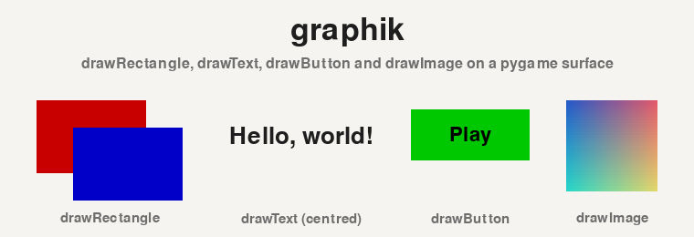
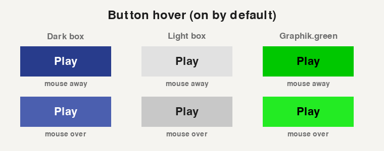

# Graphik
[](https://github.com/Stephenson-Software/graphik/actions/workflows/test.yml)

This library assists developers with graphics programming.



*Every draw method, rendered by graphik itself (`scripts/make_readme_images.py`).*

## Installation
graphik is released as git tags, not on PyPI. Install a release from its tag's
archive (no `git` needed):
```bash
pip install "graphik @ https://github.com/Stephenson-Software/graphik/archive/refs/tags/v0.5.2.zip"
```
In a `requirements.txt`, use the same line without the quotes. See
[RELEASING.md](RELEASING.md) for how releases are cut.

## Dependents
These games use graphik. When a release goes out, each one gets a pull request
that bumps the tag in its `requirements.txt`:

| Game | Repository |
|---|---|
| Roam | [Preponderous-Software/roam](https://github.com/Preponderous-Software/roam) |
| Ophidian | [Preponderous-Software/ophidian](https://github.com/Preponderous-Software/ophidian) |
| Apex | [Preponderous-Software/apex](https://github.com/Preponderous-Software/apex) |
| Rock Paper Scissors 2D | [Stephenson-Software/Rock-Paper-Scissors-2D](https://github.com/Stephenson-Software/Rock-Paper-Scissors-2D) |
| Tic Tak Toe | [Stephenson-Software/Tic-Tak-Toe](https://github.com/Stephenson-Software/Tic-Tak-Toe) |

## Usage
```python
import pygame
from preponderous.graphik import Graphik

pygame.init()
gameDisplay = pygame.display.set_mode((900, 600))
graphik = Graphik(gameDisplay)

running = True
while running:
    for event in pygame.event.get():
        if event.type == pygame.QUIT:
            running = False

    graphik.beginFrame()  # optional: buttons fire once per click instead of while held
    gameDisplay.fill(Graphik.black)
    graphik.drawRectangle(100, 100, 200, 50, Graphik.blue)
    graphik.drawText("Hello, world!", 200, 125, 24, Graphik.white)
    graphik.drawButton(100, 200, 200, 50, Graphik.green, Graphik.black, 24, "Click me", lambda: print("clicked"))
    graphik.drawImage("path/to/image.png", 100, 300, 200, 200)  # replace with a real image file
    pygame.display.update()
    graphik.endFrame()

pygame.quit()
```

`Graphik` only paints the surface: nothing appears in the window until `pygame.display.update()` (or `pygame.display.flip()`) is called, and no `Graphik` method calls either. `drawButton` reads the mouse state, which pygame refreshes only while events are being processed, so it belongs in a loop that handles them, as above.

Public `Graphik` methods:
- `Graphik(gameDisplay=None)` — construct a helper bound to a pygame display surface (creates a default 900x600 window if none is given — replacing, not reusing, any display mode already set, so an existing window is resized to 900x600).
- `getGameDisplay()` — returns the bound display surface.
- `getVersion()` — returns the installed graphik version string.
- `drawRectangle(xpos, ypos, width, height, color)` — `xpos`/`ypos` are the rectangle's top-left corner.
- `drawText(text, xpos, ypos, size, color)` — `xpos`/`ypos` are the **center** of the rendered text, not its top-left corner. This differs from `drawRectangle`, `drawButton` and `drawImage`, which all position their top-left corner at the given coordinates. Glyph edges are antialiased, blending with whatever is already on the surface. The text is always rendered as a single line — a `"\n"` is not a line break, so multi-line text needs one call per line — and a null character (`"\0"`) raises `ValueError` before anything is painted.
- `beginFrame()` — call once at the top of each frame to make `drawButton` fire once per click instead of while held. Calling it again in the same frame does nothing, so nested screens can each call it. A press that is already held when the first `beginFrame()` runs, or that slides onto a button while held, doesn't count, and each press fires at most one button.
- `endFrame()` — call once at the end of each frame started with `beginFrame()`. A frame that misses it (an exception, an early return) doesn't leave clicks stuck: the next `beginFrame()` notices the mouse button changed and takes a new snapshot.
- `drawButton(xpos, ypos, width, height, colorBox, colorText, sizeText, text, function)` — draws a rectangle and centered text, and calls `function()` when the button is clicked. By default it fires on every call where the mouse is held inside the button with button 1 down (once per call, not once per click), as earlier versions did. After the first `beginFrame()` call on the instance, it fires once per click instead: only in the frame where button 1 goes down inside the button. While the mouse is over the box, the box is drawn in a lifted color (light colors darken by 25, dark ones lighten by 35, per channel, clamped; the label color is unchanged), so it reads as clickable. The clickable region is exactly the drawn box — `xpos` through `xpos + width - 1`, and `ypos` through `ypos + height - 1` — so buttons laid out edge to edge share no clickable coordinate. The hit test uses `pygame.mouse.get_pos()`, which is in window coordinates, so this only holds when the `Graphik` is bound to the display itself (or another surface whose top-left sits at the window's origin): bound to a subsurface or an off-screen surface blitted elsewhere, the box is painted at that surface's position but stays clickable at `xpos`/`ypos` relative to the window. The label is not clipped to the box: one too large for it overflows past the box edges, and that overflow is painted but not clickable. Reading the mouse needs the video system, so unlike `drawRectangle` and `drawText` it raises `pygame.error` (after painting) when neither `pygame.init()` nor `pygame.display.init()` has been called, even for an off-screen surface; no display mode is needed.

  

  *The hover lift, rendered by `scripts/make_readme_images.py`.*
- `drawImage(filePath, xpos, ypos, width, height)` — caches the loaded and scaled surface by `filePath`, so an image edited on disk mid-run will not be picked up until the process restarts. `filePath` may be a `str` or a `pathlib.Path`, and is used as the key exactly as given: two spellings of one file (relative and absolute, or a `str` and a `Path`) are cached, and loaded, separately. Only the most recently requested size is kept per path, so drawing the same file at two alternating sizes rescales it on every call. Unlike the other draw methods, it raises `pygame.error` unless a display mode has been set with `pygame.display.set_mode`, even when the `Graphik` is bound to an off-screen surface. Only the first load of a path needs one: a path already in the cache keeps drawing to an off-screen surface with no display mode set.

Positions passed to the draw methods need not lie on the surface: anything drawn across its edge (including at negative coordinates) is clipped to it, with the part that falls off simply not painted — nothing raises, and nothing is shifted to fit.

A zero `width` or `height` draws no shape and raises nothing, and a `drawButton` sized that way has no clickable region (its label, if non-empty, is still painted, centered on `xpos + width // 2`, `ypos + height // 2`). A negative size is not mirrored into a normal rectangle: `drawRectangle` and `drawButton` likewise draw no shape (with no clickable region), but `drawImage` raises `ValueError`.

Fractional positions and sizes are accepted: `drawRectangle`, `drawButton` and `drawImage` truncate each of `xpos`, `ypos`, `width` and `height` toward zero on its own, so a box at `10.7` with a width of `5.9` covers pixels 10 through 14, and a size below one pixel draws nothing. `drawText` accepts a fractional center, but its `size`, like `drawButton`'s `sizeText`, must be an `int` (a float raises `TypeError`, unless it is a whole number whose font is already cached, in which case the cached font is used). `drawButton`'s hit test compares the mouse against the unrounded values, so with fractional arguments its clickable region can be up to a pixel off from the drawn box on each edge; pass integers where the two must line up exactly.

`pygame.quit()` destroys the display surface and any subsurface of it, so a `Graphik` bound to either must not draw again until a live surface is assigned to its `gameDisplay` attribute (or a new `Graphik` is built). The failure depends on the pygame version and need not be an exception: on pygame 2.1.2 `drawRectangle` segfaults the process. A `Graphik` bound to an ordinary off-screen surface keeps working across a restart.

Color constants: `Graphik.black`, `Graphik.white`, `Graphik.red`, `Graphik.green`, `Graphik.blue`.

An alpha component in a fill color (`(r, g, b, a)`) does not make `drawRectangle` or `drawButton`'s box translucent: on the display the shape is painted opaquely whatever `a` is, and on a surface with per-pixel alpha (`pygame.SRCALPHA`) the color's alpha replaces the pixels' own rather than blending over them. `drawText`'s `color` and `drawButton`'s `colorText` ignore an alpha component altogether: the text is painted as if `a` were 255, on the display and on a per-pixel alpha surface alike (only the antialiased glyph edges blend with what is underneath).

## 3D grid view (optional)

`preponderous.graphik.grid3d` draws a grid game's board in 3D with
[Strata](https://github.com/Preponderous-Software/strata): tiles, a frame, and
pieces standing on cells that slide smoothly between cells from one game tick
to the next. A game describes its board once and reports what is on each cell
every tick; the look lives in a `Theme`. It needs the optional Strata binding
and runs on Linux and Windows desktops, and in the browser under pygbag
(see [In the browser](#in-the-browser)):

```bash
pip install "graphik[strata] @ https://github.com/Stephenson-Software/graphik/archive/refs/tags/v0.5.2.zip"
```

```python
from preponderous.graphik.grid3d import (
    SPHERE, Grid3DView, GridBoard, Label, Piece, PieceStyle, Theme, Unavailable,
)

theme = Theme(pieces={"pawn": PieceStyle(SPHERE, (0.9, 0.25, 0.2))})
try:
    view = Grid3DView.open(900, 700, "My game")
except Unavailable as reason:
    print("No 3D here:", reason)  # keep the 2D game
else:
    view.setBoard(GridBoard(8, 8, theme))
    view.setPieces([Piece("p1", 3, 4, "pawn")], tickSeconds=0.15)  # once per tick
    view.setLabels([Label("Score: 0", 18, 16, 24)])                # when it changes
    view.frame()                                                    # once per frame
```

- `Piece(id, column, row, style)`: keep `id` stable so the piece slides; `chain`/`link` join neighbouring pieces (a snake's body); `interpolate=False` makes it jump; `scale`, `color` and `facing` vary one piece.
- `PieceStyle(kind, color, height, size, lift, glow, tones, extras)`: `glow` adds a point light; `extras` draws decorations such as eyes.
- `Grid3DView.open(..., headless=True)` renders off-screen for tests and screenshots (`savePng`); `reducedMotion=True` makes pieces jump instead of slide.
- `Unavailable` says in plain words why 3D can't run (no binding, no library for the system, no window); the game should fall back to its 2D view.
- Everything except `Grid3DView.open` is plain Python, so scene code can be unit-tested without a GPU. Importing `grid3d` loads neither Strata nor pygame.
- `PieceStyle.extras(piece, x, z, baseY)` returns shapes placed relative to the piece: x and z measured from the given `(x, z)`, so moving the piece moves them all the same way. The browser backend sends them as offsets from the piece and relies on this.

Every public class and function, with an example for each part, is in the [grid3d API reference](docs/grid3d.md).

### Helpers for a game's 3D view

So that games stop hand-building the same pieces:

- **Picking.** `view.pickCell(x, y)` (or `pickCell(camera, board, x, y, width, height)`) gives the `(column, row)` under a pointer, or `None`; the whole cell counts, gaps between tiles included. `projectToScreen(camera, point, width, height)` and `cellScreenPosition(camera, board, column, row, width, height, y)` go the other way, for aiming a tap at a piece or putting a note beside a tile. They use the same look-at and perspective the view asks Strata for.
- **Text.** Strata's built-in font is an 8 x 8 bitmap font in which every character is exactly `pixelSize` wide. `measureText(text, pixelSize)`, `fitText(text, width, pixelSize)` (cut with `...`), `wrapText(text, maxWidth, pixelSize)` (greedy word wrap) and `centredLabel(text, x, y, pixelSize, color, rise=0.5)` build on that.
- **Screen buttons.** `Button(x, y, width, height, text, color, textColor, pixelSize, function)` draws a panel and a centred label (`button.draw(pointer)`), hit-tests with `drawButton`'s edges (`contains`, `click`), and lifts under the pointer as `drawButton` does (`hoverColor`). Colours are 0-255, as for `drawButton`; `padding` widens a button whose label doesn't fit.
- **2D screens under a 3D view.** `ScreenRecorder` stands in for `Graphik`: a game's 2D screens draw into it as usual (`drawText`, `drawRectangle`, `drawButton`, `drawImage`; `beginFrame`, `endFrame`, `getVersion` and the colour constants are there too), the 3D view shows what they drew, and `recorder.click(pos)` runs the 2D button's own function.
- **Bigger boards.** `GridBoard(columns, rows, theme, tiles=..., mergeTiles=True, viewport=...)`: `tiles` maps a cell to its own `Tile(color, raised)`; `mergeTiles` draws each row's neighbouring tiles that look the same as one box (a 64 x 64 board of one colour is 64 boxes, not 4096); `viewport=Viewport.around(column, row, reach)` draws only a window of the board, framed and fitted as if it were the whole board, with pieces and picking still in whole-board cells.
- **Hover.** `board.scene(..., highlight=(column, row))` lays a thin slab in `Theme.highlight` on the tile under the pointer.
- **Chains.** `board.bridgePairs(pieces)` names the joined pieces and `board.bridgeShape(a, b, aAt, bAt)` draws one bridge.
- **Phones held upright.** Since 0.5.2 `fitCamera` frames a portrait window (aspect below 1) for its shape: the camera looks down more steeply (70 degrees rather than about 55), the board fills the window's width and stands in the middle of the space below a HUD, and a large board no longer runs off the sides. Landscape and square windows keep 0.5.1's framing exactly; between an aspect of 0.8 and 1 the two blend, so a resize across square doesn't jump. `fitCamera(columns, rows, aspect, top=..., bottom=...)` (and `board.camera`, `board.scene`) keep fractions of the window's height clear at the top (a HUD) and the bottom (a bar of touch keys), in any window shape; a view takes them in pixels with `view.setInsets(top=..., bottom=...)`, and picking, `cellScreenPosition` and the web view's camera follow.
- **On-screen keys for touch screens.** `TouchKeys([TouchKey("Pause", "space"), TouchKey("Shop", "p"), ...])` lays out a bar of labelled buttons along the bottom of the screen, each at least 44 CSS pixels each way, in rows of equal buttons (up to three rows on a portrait screen, one on a landscape one; when the keys don't all fit, the last button is *More*, which pages through the rest). A tap on one, `keys.press(position, width, height, pygame, scale)`, posts the same `KEYDOWN` and `KEYUP` the keyboard would (marked `touchKey=True`), so the game's own key handling does the work in both views; a press off the bar returns `None` and is the game's. The 2D view draws the bar with `keys.draw(graphik, width, height, scale)`, the 3D view adds `keys.overlay(width, height)` (labels and panels) to its HUD, both from one `keys.layout(...)` and one hit test. Sizes are worked out in CSS pixels: `scale` is the surface's CSS pixels per pixel (1 for the web view; for a 2D canvas the browser scales, see `keys.below(width, height, pageWidth, pageHeight)`, which gives the band to add under a 2D board and the canvas's scale). `keys.bandHeight(...)` is how much of the screen the bar takes, for `view.setInsets(bottom=...)` and the HUD. Show the keys only on touch screens: `grid3d.web.touchScreen()` is true when the page sees a coarse pointer or a touch (`?touch=1` or `?touch=0` in the address says so for testing; `GRAPHIK_TOUCH=1` outside a browser).

### In the browser

Under [pygbag](https://pypi.org/project/pygbag/) (`sys.platform == "emscripten"`), `Grid3DView.open()` returns a `grid3d.web.Grid3DWebView`: the same calls, drawn by Strata's grid relay, a small Strata web-kit scene in the page (Strata's `web/kit/grid-relay`, whose `WIRE.md` specifies the messages). Python sends the board, each tick's pieces, the HUD and the camera as small versioned binary messages; the page slides the pieces between ticks itself, so nothing is sent per display frame. A game that builds whole `Scene`s can keep calling `drawScene()` every frame; only what changed is sent.

- `view.ready` turns true once the page has loaded the 3D view; `view.failure()` says why it couldn't. `open()` raises `Unavailable` on a page without the relay.
- `view.pollEvents()` returns Strata-style events (keys with desktop Strata's scancodes, mouse, wheel, resize, and `FINGER_*` for touch), and `grid3d.web.toPygameEvents(events, pygame)` turns them into pygame events, so a game's 2D input code runs unchanged. It converts desktop Strata events too.
- The page: build with `pygbag --template <grid3d.web.templatePath()> ...`, a copy of pygbag 0.9.3's default template with the relay's canvas and a **2D/3D** button. The relay has to be served with the game (a browser can't fetch GitHub release assets cross-origin): `python -m preponderous.graphik.grid3d.relay --strata 0.9.0 --dest <pygbag output>` downloads Strata's `strata-<version>-wasm32-emscripten.tar.gz`, checks it against the release's `SHA256SUMS` and copies its prebuilt `kit/grid-relay/dist/` next to the page, leaving files already there (pygbag's `index.html`) alone; `--replace` replaces an earlier relay's files (never `index.html`) when moving to a newer Strata.
- Since 0.5.1 the page starts in **3D**, as a desktop `Grid3DView` game does: the relay's scripts and engine load at once, alongside pygbag, and the 2D canvas stays on screen until the 3D view is drawing the game. If 3D can't start (no WebGL 2, a file missing, too big, the engine failed), the 2D view stays, the button reads *3D unavailable* and a note under it says why in plain words. Which view a page starts in: `?view=2d` or `?view=3d` in the address (for testing and sharing; not remembered), else the player's last choice on the button (kept in `localStorage`; a stored 2D wins over the default), else the game's default, which `templatePath(defaultView="2d")` makes 2D. A page that starts in 2D downloads nothing of the 3D view (not even the relay's three small scripts) until the button is pressed. `grid3d.web.wants3D()` tells the game 3D is on and the relay's scripts are in, so `Grid3DWebView.open()` can begin, and `set3D(False, reason)` turns it off.
- **Too slow: back to 2D.** Since 0.5.3, when the 3D view stays slow once the game is drawing in it, the page goes back to 2D and the note says why in plain words ("this device draws the 3D view too slowly"). Strata's kit first gives up pixel density (down to 1) and then its quality tier; only once it has nothing left to give up, and the drawing itself stays slow for 5 seconds, does the page switch: second by second, the typical frame (the median time between the page's frames) is over 66 ms, the relay's own drawing (its `stats()` `cpuMs`) is at least a quarter of it, and the kit's own average frame (`frameMs`) is over 66 ms too. A game that stops the page now and then (building and sending a board in Python) makes a few long gaps, not a slow typical frame, and a game that is slow every frame while the drawing is cheap wouldn't be helped by 2D, so neither switches. Counting starts 3 seconds after the game's first message to the 3D view, so pygbag's boot and the first shader compile aren't counted, and stops while the tab is hidden. The switch isn't remembered as the player's choice: the button still offers 3D, and once the player chooses 3D again the page leaves it alone until it is reloaded. `?slow=0` in the address turns the switch off (for testing on a machine that draws in software). `Graphik3D.slowed()` in the page says it happened, and `Graphik3D.speed()` gives the last second's readings.
- The button sits in the page's top right corner. Since 0.5.3 it is a switch with both views on it, *2D* and *3D*, the one on show lit, so it reads as a choice rather than as a status; to a screen reader it is a toggle named "3D view" (`aria-pressed` while 3D is on), and it is at least 44 CSS pixels each way. `grid3d.web.buttonArea()` gives its `(x, y, width, height)` in CSS pixels, the units of the web view's labels and panels, so a HUD can keep text out from under it (`None` outside a browser). The page never scrolls (`overflow: hidden`), so a phone's browser can't widen it to fit pygbag's 50000-pixel measuring element and push the button off screen, and its one viewport tag sets `width=device-width` (pygbag 0.9.3's default page has a second one that overrides it). Strata's own loading and failure overlay is hidden, so it never covers the 2D game.

In a game's `browser.yml`, where graphik is installed into `src/` for pygbag:

```yaml
      - name: Build with pygbag, on graphik's 3D page template
        run: |
          TEMPLATE="$(PYTHONPATH=src python -c 'from preponderous.graphik.grid3d.web import templatePath; print(templatePath())')"
          python -m pygbag --build --template "$TEMPLATE" --title "My game" src
      - name: Add Strata's grid relay next to the page
        run: PYTHONPATH=src python -m preponderous.graphik.grid3d.relay --strata 0.9.0 --dest src/build/web
```

## Dependencies
- pygame
- optional: `strata-engine` 0.8.0 for the 3D grid view on the desktop (the `strata` extra)

Python 3.9 or newer is required (`requires-python` in [pyproject.toml](pyproject.toml)). The test suite is run against 3.9 through 3.13; see [`.github/workflows/test.yml`](.github/workflows/test.yml) for why 3.13 is the ceiling.

## Development
```bash
python -m venv .venv
source .venv/bin/activate
pip install -e ".[test]"
pytest
```
The suite is headless: `src/test/python/conftest.py` sets `SDL_VIDEODRIVER`/`SDL_AUDIODRIVER` to `dummy` before pygame touches a display, so no window is created and the tests run on a machine with no display attached. `pytest` alone works from the repo root because `[tool.pytest.ini_options]` in `pyproject.toml` points `testpaths` at `src/test/python` and `pythonpath` at `src/main/python`. `.github/workflows/test.yml` runs the same `pip install -e ".[test]"` + `pytest` sequence — preceded by a compile check and an import smoke test, across the supported Python versions — on every pull request and on every push to `main`. A second job, *Install from a release archive*, packs the commit the way GitHub serves a tag's archive, installs it into a fresh venv as a consumer would, and draws with it. A push to a branch with no open pull request is not covered, so run `pytest` locally before opening one.

The README images are generated, not hand-made. After changing how something draws, regenerate them with
`SDL_VIDEODRIVER=dummy python scripts/make_readme_images.py` and commit the updated `docs/images/*.png`.

## Projects
The games that use graphik are listed under [Dependents](#dependents) above.

## 📄 License

graphik is licensed under the [MIT License](LICENSE).

Copyright © 2022–2025 Daniel McCoy Stephenson. All rights reserved.

Permission is hereby granted, free of charge, to any person obtaining a copy of this software 
and associated documentation files (the “Software”), to deal in the Software without restriction, 
including without limitation the rights to use, copy, modify, merge, publish, distribute, sublicense, 
and/or sell copies of the Software, and to permit persons to whom the Software is furnished to do so, 
subject to the following conditions:

The above copyright notice and this permission notice shall be included in all copies 
or substantial portions of the Software.

THE SOFTWARE IS PROVIDED “AS IS”, WITHOUT WARRANTY OF ANY KIND, EXPRESS OR IMPLIED, INCLUDING BUT 
NOT LIMITED TO THE WARRANTIES OF MERCHANTABILITY, FITNESS FOR A PARTICULAR PURPOSE AND NONINFRINGEMENT. 
IN NO EVENT SHALL THE AUTHORS OR COPYRIGHT HOLDERS BE LIABLE FOR ANY CLAIM, DAMAGES OR OTHER LIABILITY, 
WHETHER IN AN ACTION OF CONTRACT, TORT OR OTHERWISE, ARISING FROM, OUT OF OR IN CONNECTION WITH THE 
SOFTWARE OR THE USE OR OTHER DEALINGS IN THE SOFTWARE.

---

### Why MIT?
The **MIT License** offers maximum freedom for developers to integrate **graphik** into their projects, whether for games, simulation tools, or research applications. This permissive approach is intended to boost adoption, encourage experimentation, and position **graphik** as a widely used rendering and visualization library.

### Open Source Commitment
There are **no plans to move away from open source** for **graphik**. The project will remain freely available under an OSI-approved license, with active encouragement for community use and contributions.
